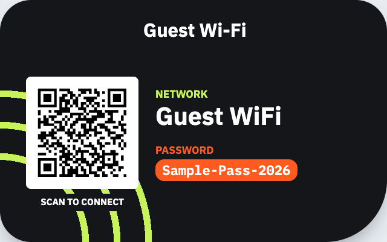
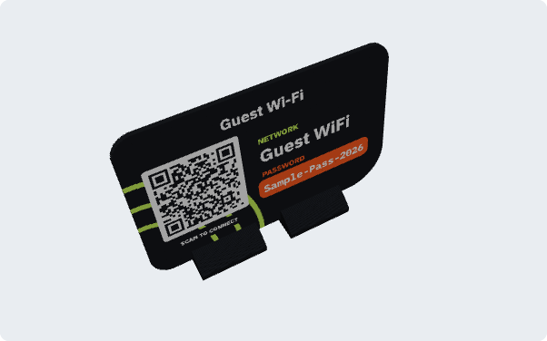
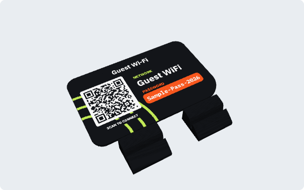

# Wi-Fi Card Generator

Make a guest Wi-Fi info card for a meeting room, reception desk, or shop counter: generate a password, add a Wi-Fi QR code, then print it on paper or export a 3D-printable model.

Everything runs in your browser. The SSID, password, and logo are never sent anywhere.

**Live demo:** https://tak-55.github.io/wifi-card-generator/

| Assembled | As exported |
| --- | --- |
|  |  |

The images above use a dummy password (`Sample-Pass-2026`).

## Features

### Network and password

- Security type: WPA2/WPA3, WEP, or open (no password). Hidden SSID is supported.
- Three password modes:
  - **Readable**: three words, a separator, four digits, and an optional symbol (e.g. `Heron-Dune-Zephyr-8684?`). Easy to read aloud and type on a phone.
  - **Random**: 10 to 32 characters with upper/lower case, digits, and optional symbols. Can exclude look-alike characters (`0 O 1 l I`).
  - **Manual**: type your own.
- Passwords come from `crypto.getRandomValues` with rejection sampling, so there is no modulo bias.
- An estimated strength in bits is shown, and WPA length (8 to 63) is checked.

### Card design

- Card (150 × 94 mm by default) with all four corners rounded (extra large at the bottom right) and three concentric "signal" arcs radiating from the bottom-left corner. The QR code sits on the left; the SSID and the password (on a colored pill) are on the right.
- Your logo (SVG/PNG, transparent or white background) or a built-in Wi-Fi icon, plus a heading such as your company name.
- Four colors you can change: base, white, and two accents.
- English or Japanese labels, an optional outer frame, optional signal arcs, and an optional one-line note at the bottom (empty by default).
- Optional logo in the center of the QR code (your logo, or a Wi-Fi icon if none is set). It switches the QR to error correction level H and clears about 7% of the code area; it applies to the card, the 3D models, and the QR SVG/PNG downloads. Scan the result before you print or hand it out.
- The password can be left off the card, so the QR code is the only way in.

### Output

- **Paper**: print straight from the browser (only the card is printed).
- **QR code**: save as SVG or PNG. The raw `WIFI:` string is shown so you can check what the QR code contains.
- **3D printing**: see below.

## 3D printing

The card is built as a height map in the browser and exported as meshes. No server or slicer plugin is needed.

A WebGL viewer (no dependencies) shows the exported meshes in color, either assembled (the card standing in the two stand clips) or as exported (card and stand parts side by side). Drag to rotate, scroll to zoom. A flat top-down color-layer preview is shown below it.

| Export | Use it for |
| --- | --- |
| 3MF (multi-color) | Multi-color printers (AMS, MMU, etc.). Contains one part per color, with filament assignments. |
| Per-color STL (ZIP) | Slicers that don't split 3MF parts. Load all files together as one object with several parts. |
| Color-change STL | Single-nozzle printers. One mesh, with a filament change at a set height. |
| Stand STL | Two ramp-shaped clips that hold the card upright, leaning back about 10°. The slot has a flared mouth for easy insertion. |

Finish options:

- **Flat**: colors are inlaid into the top surface, so the surface is level. Best for multi-color printing.
- **Raised**: text, QR, and logo stand up from the base. Pause at the base thickness and swap filament for a two-color print.

Adjustable parameters: card width (100 to 220 mm), plate thickness (2 to 6 mm), color layer height (0.4 to 1.2 mm), and mesh resolution.

Printing tips:

- Thin strokes can get lost with a 0.4 mm nozzle. A card width of 150 mm or more is the safest. The page warns you when QR cells get smaller than 1 mm.
- Check that the printed QR code scans before you put the card on display.
- The 3MF uses PrusaSlicer's part metadata. Other slicers may need the per-color STL files.

## Customizing for your organization

Edit `config.js` to change the defaults: heading, logo path, SSID, footer text, label language, frame, accent, and colors. Put your logo at `assets/logo.svg` (a single-color transparent SVG or PNG looks best); if there is no logo, a Wi-Fi icon is shown.

Settings changed in the page are saved in that browser's local storage and take priority over `config.js`. "Reset to defaults" brings the defaults back. Passwords are never saved.

## Project layout

- `index.html`: the whole app (UI, password generator, QR, rasterizer, mesh and 3MF/STL writers)
- `config.js`: site defaults
- `vendor/qrcode.js`: QR encoder ([qrcode-generator](https://github.com/kazuhikoarase/qrcode-generator) 1.4.4, MIT)
- `assets/`: logo and other images

It is a static site with no build step. To run it locally, serve the folder with any static server, for example `python3 -m http.server`.

Fonts (IBM Plex Sans JP and IBM Plex Mono) are loaded from Google Fonts. If they can't be loaded, OS fonts are used instead.

## Security notes

- Don't commit real Wi-Fi passwords to a repository. Generate them in the browser each time.
- A Wi-Fi QR code contains the password in plain text. Anyone who can see the card can join the network, so rotate the password when staff or visitors change.

## License

[MIT](LICENSE). The bundled `vendor/qrcode.js` is also MIT-licensed (see its header).
